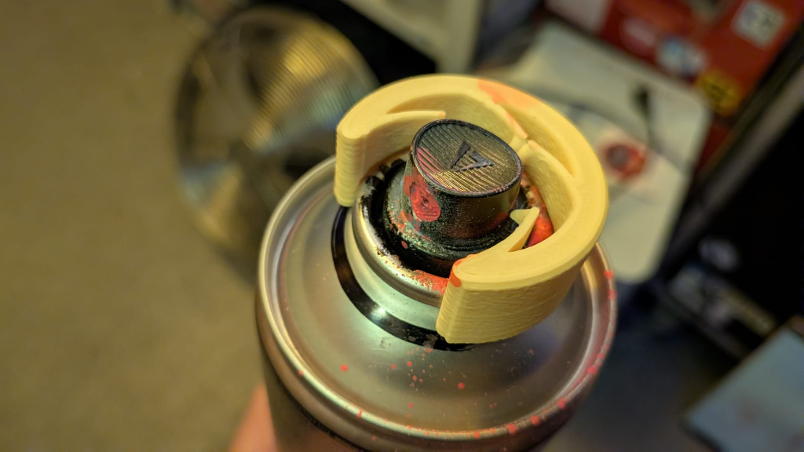
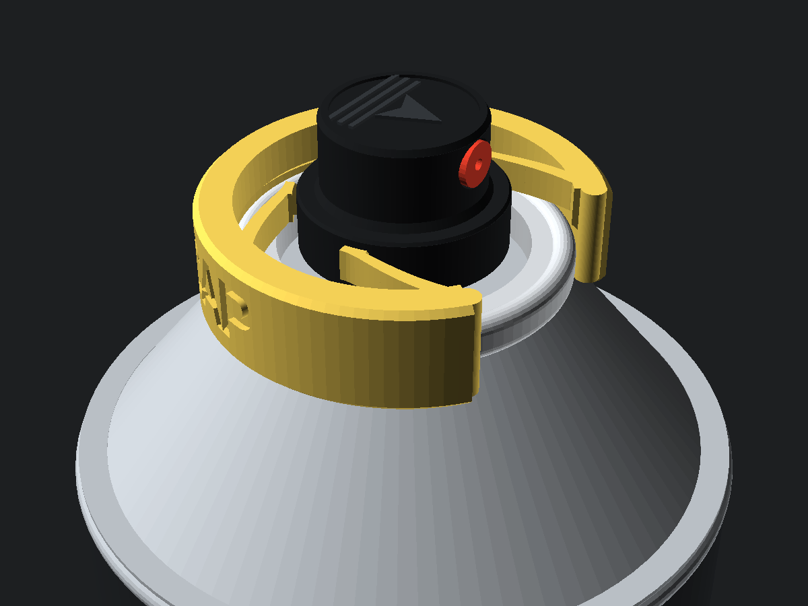
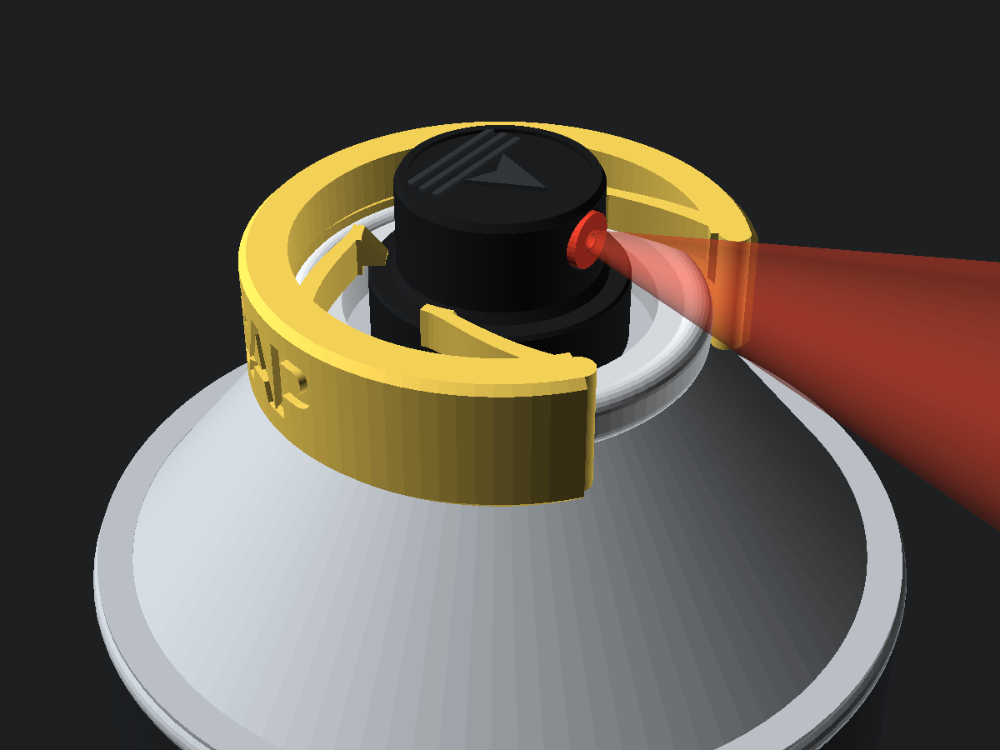
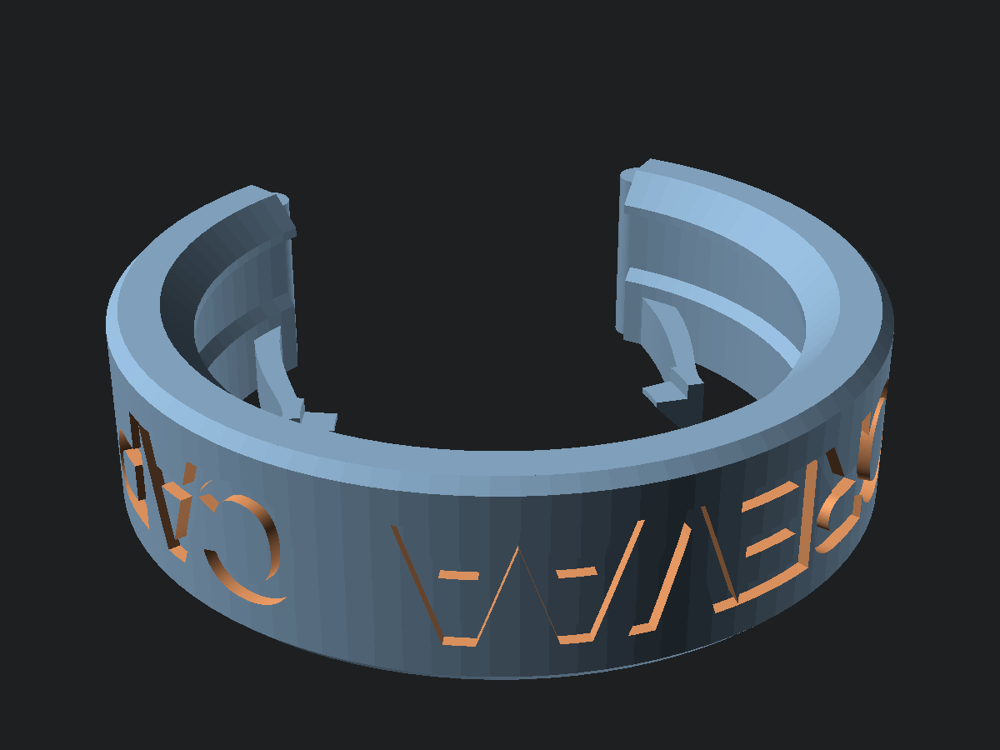

# FOREVAA CAP

> **Click it on. Stomp the cap. Walk away.**  
> **One tiny 3D-printed ring that turns any rattlecan into an unstoppable paint bomb.**

---

## WTF Is This?

You know the old-school trick: tape down a fat cap, wedge a coin under the lip, chuck the can into a room or roll it down a hallway, and let it empty its guts out. Problem is, tape slips, coins pop out, and half the time you blast your own fingers pink before the thing even leaves your hand.

**FOREVAA CAP** is the clean, dirty fix.

It’s a tiny, 10-minute piece of 3D-printed plastic with four little inward-pointing claws in the middle—basically **a tight little plastic arsehole / sphincter** that sits around your spray cap.

1. **Click the ring onto the inner metal rim** of any standard spray can. In this position, the cap is still sitting nice and high. **Zero spray. Totally safe in your pocket or bag.**
2. When it’s go-time, **shove the cap down through the hole**. Those four little sphincter teeth bend wide to swallow the lower rim of the cap—***CLICK***—and clench shut right over its shoulder.
3. **There is no going back.** Once that cap is past the ring's arsehole, it is locked down **FOREVAA**. The tall nozzle sticks straight up through the middle and blasts non-stop until the can is bone dry.

| 1. Chilling (Safe / Standby) | 2. Full Send (Locked FOREVAA) |
| :---: | :---: |
|  |  |
| *Clipped on the inner rim. Cap sits above the sphincter teeth—won't go off in your bag.* | *Push the cap down once—the 4 claws clench shut over the lower rim and it blasts forever.* |

---

## Who Made This Crap?

- **Invented by:** [**Veli Silver**](https://www.instagram.com/veli_silver/)
- **Late-Night Vibe-Coding & Test Prints:** [**Veli Silver**](https://www.instagram.com/veli_silver/) & [**dusjagr**](https://www.dusseiller.ch/) — yelling prompts at Gemini Argon while melting plastic until the snap felt nasty enough.

### Veli Silver × dusjagr: The Backstory

[**Veli Silver**](https://www.instagram.com/veli_silver/) (moving between Zürich and Ljubljana—street bombings, fire-extinguisher paint attacks, demolition-site murals, and turning urban spaces upside down) and [**dusjagr**](https://www.hackteria.org/wiki/Dusjagr) (DIY mad scientist, hardware hacker, and instigator behind [**Hackteria**](https://www.hackteria.org/) and [**SGMK**](https://www.mechatronicart.ch/)) have been crossing paths in underground squats, hackerspaces, and makeshift street labs from Europe to Southeast Asia for years:

- **Zürich ([Zentralwäscherei](https://zentralwaescherei.space/) / [Bitwäscherei](https://www.bitwaescherei.ch/)):** Hanging around the old industrial laundry in Zürich—home to the [**Bitwäscherei**](https://www.bitwaescherei.ch/) collective and the [**Hackteria ZET**](https://www.hackteria.org/wiki/Hackteria_ZET_%E2%80%93_Open_Science_Lab_in_Z%C3%BCrich) lab.
- **Ljubljana ([Kersnikova](https://kersnikova.org/) / [MobileLabs](https://www.hackteria.org/wiki/MobileLabs_Hackathon)):** Old stomping grounds in Ljubljana’s squat, street-art, and underground lab scene.
- **Chiang Mai, Thailand ([*LLL CoLaboratory / CNX OpenLab*](https://www.hackteria.org/wiki/LLL_CoLaboratory)):** Crossing paths again in Chiang Mai's old town for the *Laab Lu Lao (LLL) CoLaboratory*—mixing raw street energy, spiced minced meat, local lao, and DIY hardware hacking.

At first we tried over-engineering tall 3-legged bridges with 3D-printed thumbscrews and zip-tie plungers (buried in [`prototypes/`](prototypes/)). They looked like sci-fi tripods and snapped right off along the 3D-print layer lines. So we threw all that out and stripped it down to the raw minimum: **one flat C-ring, four flexing sphincter claws, one click, forever spray.**

---

## Print It Yourself (10 Minutes, Zero Supports)

Grab **[`forever_inner_ring_cap.stl`](forever_inner_ring_cap.stl)** and throw it on any cheap FDM printer:

- **Drop it flat:** It prints upside-down on its flat face (`Z = 0`). **No supports, no brim, no bullshit.**
- **Plastic:** **PETG**, **ASA**, or **Tough PLA / PLA+** so the four claws have good springy snap without cracking.
- **Walls:** **3–4 perimeters** (`0.15 mm` or `0.20 mm` layer height) so the curved claws print as solid continuous loops of plastic.

Want the nerdy CAD dimensions, OpenSCAD Customizer variables, and engineering notes? Check **[`tech.md`](tech.md)**.

---

## What's in the Box

- **[`forever_inner_ring_cap.stl`](forever_inner_ring_cap.stl)** — Ready-to-print **FOREVAA CAP** STL (`"perfect"` preset).
- **[`forever_inner_ring_cap.scad`](forever_inner_ring_cap.scad)** — Parametric OpenSCAD file (change cap size, claw stiffness, or the text on the side).
- **[`forever_inner_ring_cap.json`](forever_inner_ring_cap.json)** — Saved `"perfect"` preset for standard cans & caps.
- **[`tech.md`](tech.md)** — Full technical documentation & OpenSCAD parameters.
- **[`prototypes/`](prototypes/)** — The graveyard of over-complicated V1 & V2 tripod prototypes.

---

## Links & Crew

- **Veli Silver:** [@veli_silver](https://www.instagram.com/veli_silver/)
- **dusjagr (Marc R. Dusseiller):** [dusseiller.ch](https://www.dusseiller.ch/) · [Hackteria Wiki: Dusjagr](https://www.hackteria.org/wiki/Dusjagr)
- **Hackteria:** [hackteria.org](https://www.hackteria.org/)
- **LLL CoLaboratory (Chiang Mai):** [hackteria.org/wiki/LLL_CoLaboratory](https://www.hackteria.org/wiki/LLL_CoLaboratory)
- **Hackteria ZET (Zürich):** [Hackteria ZET – Open Science Lab in Zürich](https://www.hackteria.org/wiki/Hackteria_ZET_%E2%80%93_Open_Science_Lab_in_Z%C3%BCrich)
- **Bitwäscherei & Zentralwäscherei (Zürich):** [bitwaescherei.ch](https://www.bitwaescherei.ch/) · [zentralwaescherei.space](https://zentralwaescherei.space/)
- **SGMK:** [mechatronicart.ch](https://www.mechatronicart.ch/)

---

*Open-source street tool — print it, remix it, bomb responsibly.*
