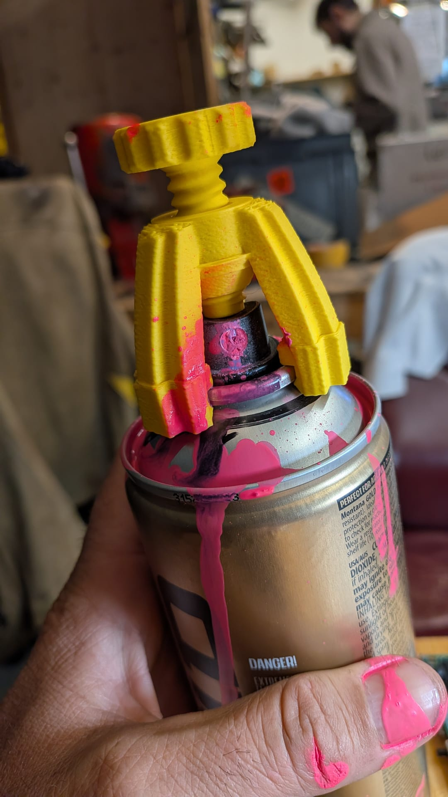
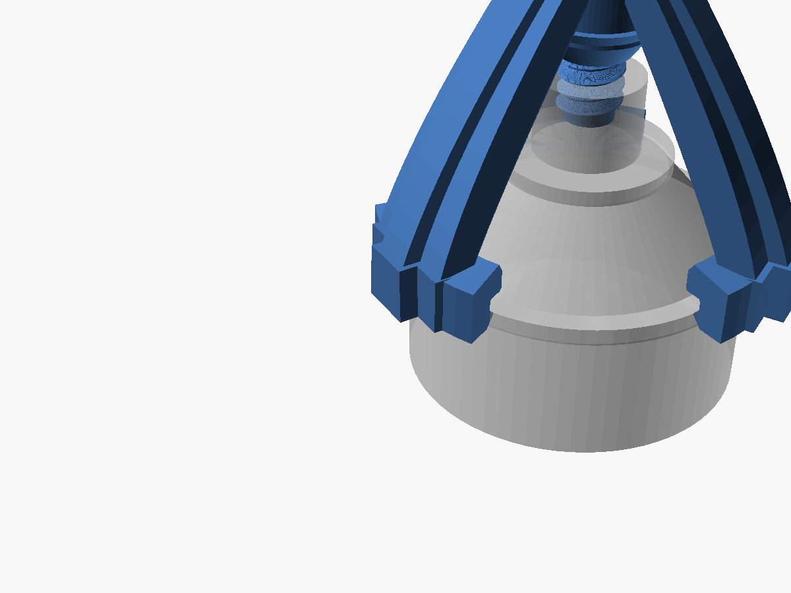
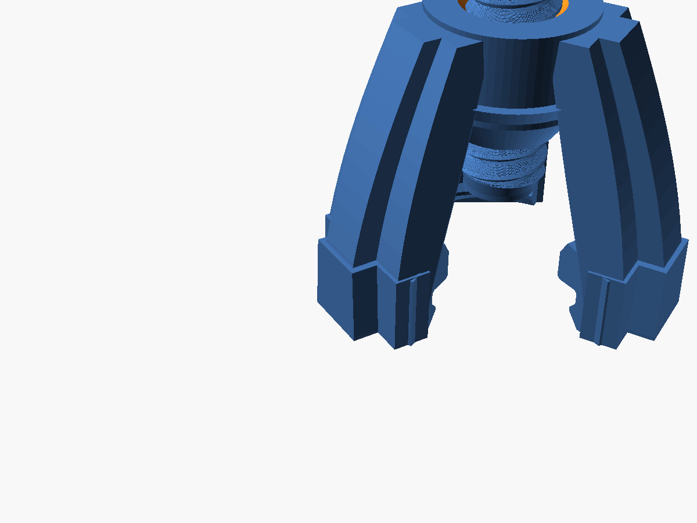

# Early Prototypes & Design Graveyard

Before landing on the minimal 1-piece **FOREVAA CAP** ([`../forever_inner_ring_cap.scad`](../forever_inner_ring_cap.scad)), we went through several over-engineered iterations. We keep them here in the repository so nobody wastes filament repeating our mistakes.

*The original 3D-printed prototype tested in the wild.*

---

## Prototype 1: The Outer-Rim Tripod + M12 Thumbscrew

| Outer Can Rim Spider Arch (V1) | Compact Inner Valve Cup Arch (V2) |
| :---: | :---: |
|  |  |
| *Clips onto the 65.5mm outer can rim bead. 40mm arch clearance + M12 thumbscrew.* | *Scaled down to the 32.7mm inner valve cup. 22mm arch clearance.* |

### How It Worked:
- **Concept:** A tall, 3-legged spider arch that snaps over the rolled metal bead (chime) of a standard 400ml aerosol can (`outer_rim_od = 65.5 mm`).
- **Trigger:** At the top of the hub, an internal 3D-printed M12 trapezoidal thread (`screw_pitch = 3.0 mm`) accepted a knurled thumbscrew with a flat bottom presser pad (`presser_tip_d = 9.5 mm`). You screwed the knob down clockwise until the nozzle was forced into full spray.

### Why It Failed (The Autopsy):
1. **Z-Axis Layer Delamination:** FDM 3D prints are weakest across horizontal layer lines (`Z`). Screwing down the plunger generates tens of Newtons of upward reaction force directly against the 40mm-tall arch legs. Under load, the legs sheared right off along the layer lines.
2. **Way Too Bulky:** It took almost 2 hours to print, required reinforced T-beam leg spines (`outer_spine_depth = 4.0 mm`), and took up way too much room in a pocket or backpack.
3. **Slow As Hell:** Screwing down an M12 thread takes 5–10 seconds of two-handed fiddling. In street conditions, you need a 1-second, one-handed activation.

---

## Prototype 2: The Inner Valve Cup Bridge

### How It Worked:
- To reduce the massive bending moment of the 65.5mm outer bridge, we scaled the legs inward to snap directly onto the 1-inch (`32.7 mm`) clinched metal valve cup around the nozzle.
- Clearance height was cut in half (from `40 mm` down to `22 mm`).

### Why It Still Wasn't Right:
- Even though the shorter legs had less leverage, it was still a multi-piece contraption (bridge + screw) subjected to vertical tensile stresses across Z-layers.
- Fine threads in plastic easily cross-thread or bind when paint starts misting around the nozzle.

---

## Prototype 3: The One-Way Ratchet Plunger

### How It Worked:
- We ditched the threaded screw and tested a vertical push-down plunger held by zip-ties and stepped ratchet teeth ("click-click").
- You pushed the plunger down once, and ratchet teeth held it down.

### Why It Was Scrapped:
- Still required 2 separate 3D-printed parts that had to be aligned and assembled.
- The vertical ratchet teeth were small and brittle when printed vertically.

---

## The Breakthrough: Killing the Bridge (Evolution to FOREVAA CAP)

After testing these prints, we realized we were over-engineering the wrong problem:
> **The spray can already has a spring-loaded nozzle and an inner metal cup right next to each other. Why build a 40mm tower above it when you can just put a flat ring around it?**

This realization led directly to the final **FOREVAA CAP** ([`../forever_inner_ring_cap.scad`](../forever_inner_ring_cap.scad)):

| Feature | Early Tripod Prototypes (V1 / V2) | Final FOREVAA CAP (V3) |
| :--- | :--- | :--- |
| **Part Count** | 2 pieces (Bridge + Thumbscrew / Plunger) | **1 single piece** |
| **Print Time** | 1.5 – 2 hours | **10 – 12 minutes** |
| **Print Orientation** | Tall upright legs (supports often required) | **Flat on print bed (`Z = 0`), zero supports** |
| **Stress Orientation** | Tensile stress across weak horizontal Z-layers | **Flexing in the `X-Y` plane along solid filament perimeters** |
| **Trigger Action** | Screwing a knob for 10 seconds | **1 click: push the cap down past the 4 sphincter claws** |
| **Standby Safety** | Awkward / could trigger if screw turned | **Clipped onto rim, cap sits high and disarmed until pressed** |
| **Front Clearance** | Blocked by one of the 3 legs unless clocked | **Wide 75° open spray window directly in front** |

---

## Prototype Archive Files

- **[`first_prototype.jpeg`](first_prototype.jpeg)** — Photo of the original 3D-printed prototype on a spray can.
- **[`forever_spray_can.scad`](forever_spray_can.scad)** — Full parametric OpenSCAD script for both Outer (`outer_bridge`) and Inner (`inner_bridge`) tripod designs with M12 trapezoidal thread generator.
- **[`forever_spray_can.stl`](forever_spray_can.stl)** — STL mesh of the 3-legged bridge.
- **[`forever_spray_can_screw.stl`](forever_spray_can_screw.stl)** — STL mesh of the M12 knurled thumbscrew.
- **[`forever_spray_can.json`](forever_spray_can.json)** — Saved presets for the OpenSCAD Customizer.
- **[`proto_v1_outer_thumbscrew.png`](proto_v1_outer_thumbscrew.png)** — 3D render of the V1 outer rim bridge.
- **[`proto_v2_inner_thumbscrew.png`](proto_v2_inner_thumbscrew.png)** — 3D render of the V2 inner valve cup bridge.
